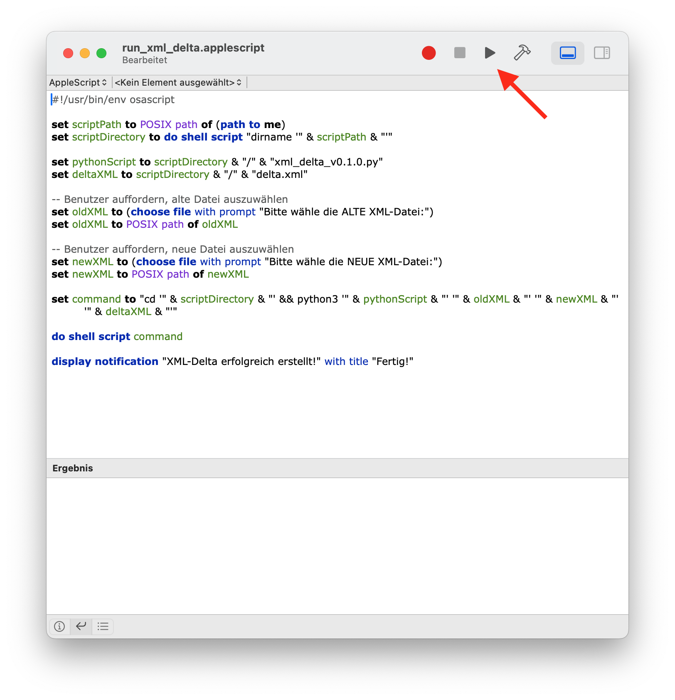

# XML-Delta
Script to compare XML file pairs and create delta files containing only new data

## Funktionsumfang
- Vergleicht alle XML-Dateipaare aus dem Ordner `Input` in einem Durchgang.
- Ordnet Dateien anhand des gemeinsamen Namensbestandteils vor dem Zeitstempel einander zu und bestimmt über den Zeitstempel im Dateinamen `ALT` und `NEU`.
- Akzeptiert ausschließlich XML-Dateien; jede Dateigruppe muss genau zwei Dateien mit unterschiedlichen Zeitstempeln enthalten.
- Erkennt unterstützte XML-Strukturen mit `item`- oder `speaker`-Elementen.
- Erkennt Konferenz-XML mit `sessions/session` und `speakers/speaker` und vergleicht Talks und Speaker getrennt über `uniqueId`.
- Ignoriert in Konferenz-XML automatisch wechselnde technische Metadaten wie `versionId`, `_id`, `__v` und `lastSavedDate`; diese gelten nicht als fachliche Änderung.
- Protokolliert für Talks und Speaker jeweils die Anzahl neuer, geänderter, gelöschter und unveränderter Einträge.
- Übernimmt bei Konferenz-XML ausschließlich neue und geänderte Talks sowie Speaker in die Delta-Datei.
- Vergleicht Einträge über `uniqueId`, wenn dieses Tag in beiden XML-Dateien vorhanden ist; andernfalls werden weiterhin Titel und Sprechernamen als Schlüssel verwendet.
- Erkennt neue und geänderte Einträge und schreibt ausschließlich diese in die Delta-XML-Datei.
- Übernimmt bei `uniqueId`-Vergleichen neue IDs ins Delta, meldet nicht mehr vorhandene IDs als gelöscht und protokolliert Änderungen an Titel oder Speaker unter `UPDATES`.
- Protokolliert unveränderte IDs als Hinweis, übernimmt sie jedoch nicht ins Delta.
- Gibt gelöschte Einträge im Log aus, übernimmt sie jedoch nicht in die Delta-Datei.
- Verarbeitet XML-Namespaces, ohne feste Namespace-Präfixe vorauszusetzen.
- Erhält Root-Element, Attribute, Namespaces und XML-Deklaration des neuen Dokuments.
- Erzeugt die Delta-Datei automatisch im Ordner `Output` mit dem Dateinamen `ALT__NEU__delta.xml`.
- Wandelt jede erzeugte Delta-XML automatisch in eine UTF-16-kodierte CSV-Datei mit dem Suffix `_UTF-16.csv` um. Wiederholte Datensätze werden als Zeilen und verschachtelte XML-Felder als Spalten ausgegeben.
- Markiert CSV-Dateien unter macOS im Finder grün, wenn sie Einträge enthalten, und rot, wenn sie leer sind. Bestehende Finder-Tags bleiben erhalten.
- Erstellt bei einem Batch-Lauf ein gemeinsames Text-Log unter `Output/Log_Batch_<Name-der-neuesten-INPUT-Datei-ohne-Erweiterung>.txt` mit übersichtlichen Überschriften pro Dateigruppe; bei einem Einzelvergleich wird das Log wie bisher pro neuer Datei abgelegt.
- Unterstützt den ausführlichen `--debug`-Modus und den `--dry-run`-Vorschaumodus.
- Gibt verständliche Validierungs- und Parsing-Fehler bei ungültigen Eingabedaten aus.
- Enthält ein macOS-AppleScript für die Ausführung per Doppelklick und das automatische Öffnen des Logs nach erfolgreicher Ausführung.

## Voraussetzungen
### 1. Python 3
- überprüfen, ob Python 3 bereits installiert ist:
  - folgenden Code kopieren: `python3 --version`
  - App TERMINAL öffnen
  - Code einfügen und mit ENTER bestätigen
  - wenn Ausgabe **"Python 3.x.y"** (oder höher):
    - weiter zu Punkt 2.
  - andernfalls:
    - Python 3 von hier herunterladen und installieren: https://www.python.org/downloads/macos/

### 2. lxml
- lxml installieren
  - folgenden Code kopieren: `pip3 install lxml`
  - App TERMINAL öffnen
  - Code einfügen und mit ENTER bestätigen

## Installation
Zunächst sicherstellen, dass die beiden Voraussetzungen erfüllt sind (siehe oben).
- Neueste Version des Tools herunterladen: https://github.com/mschuetze/XML-Delta/releases
  - das ZIP findet sich in der unteren Hälfte des Kastens, bezeichnet als **Source code (zip)**
- ZIP entpacken und im Ordner deiner Wahl ablegen (z.B. Schreibtisch)

## Benutzung
ACHTUNG: Für die Nutzung des Skripts benötigen wir sowohl das aktuelle XML, als auch das "alte".
- aktuelles XML, welches die Änderungen / Ergänzungen enthält, hier herunterladen: https://conferences-preview.s3-website-eu-west-1.amazonaws.com/#/conferences
- mittels **conferenceTransform** die 4 XML-Dateien für den Workflow erstellen
- alle alten und neuen XML-Dateien der vier Dateigruppen gemeinsam in den Ordner **INPUT** kopieren. Die Dateinamen müssen jeweils denselben Namensteil und unterschiedliche Zeitstempel im Format `(JJJJ_MM_TT-hh_mm)` enthalten.
- Datei **run_xml_delta.applescript** doppelklicken und in Skripteditor ausführen (Play-Button, oben rechts)
  
- für jedes Dateipaar werden eine Delta-XML und die dazugehörige UTF-16-CSV im Ordner **OUTPUT** generiert
- die benötigten Dateien in den Projektordner verschieben / kopieren
- weiter mit dem regulären SoMe-Programmgrafiken-Workflow

> [!IMPORTANT]
> **Bitte alle XML-Dateien im Projektordner aufbewahren und nicht löschen!**